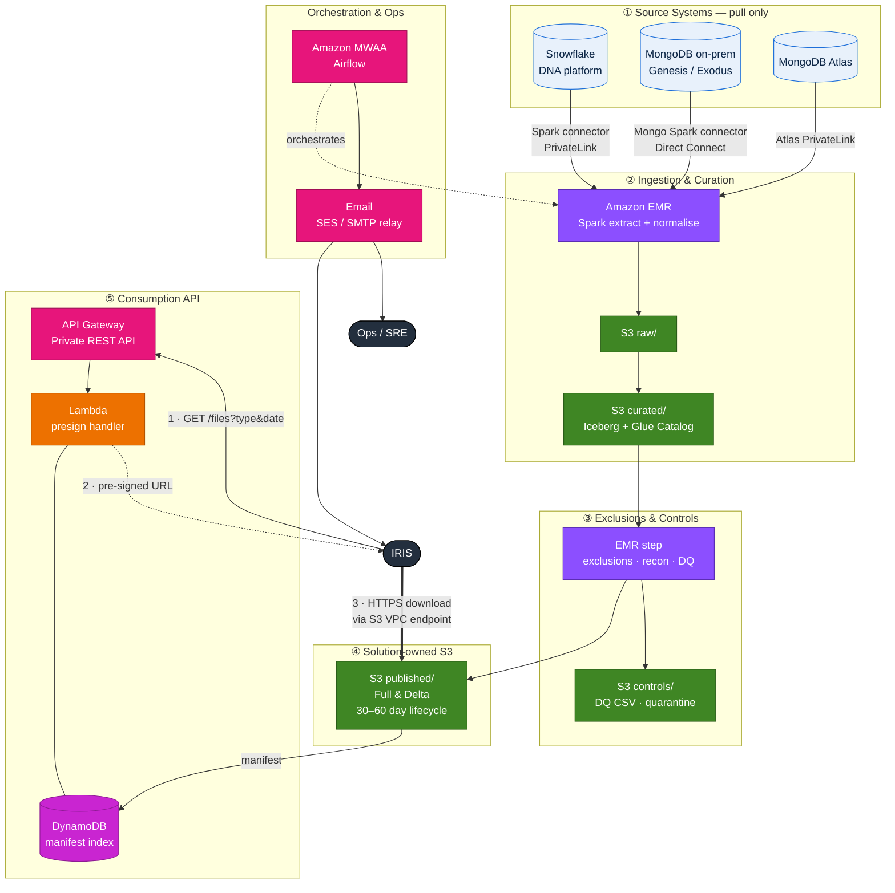
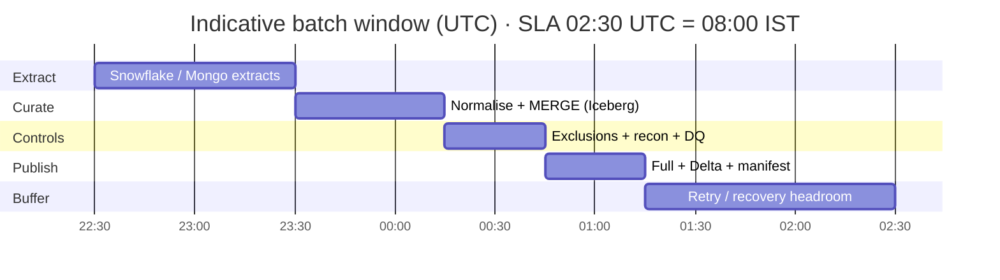
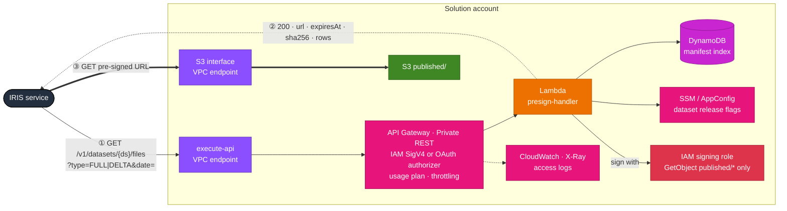
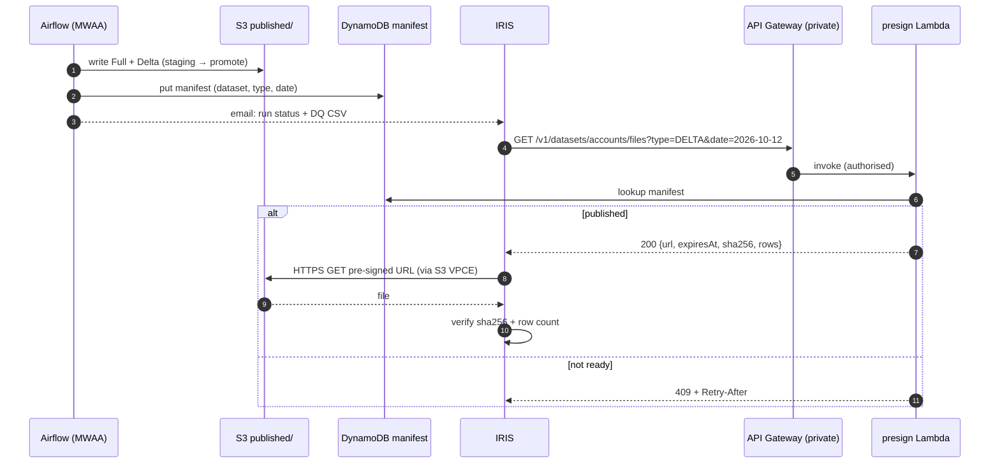
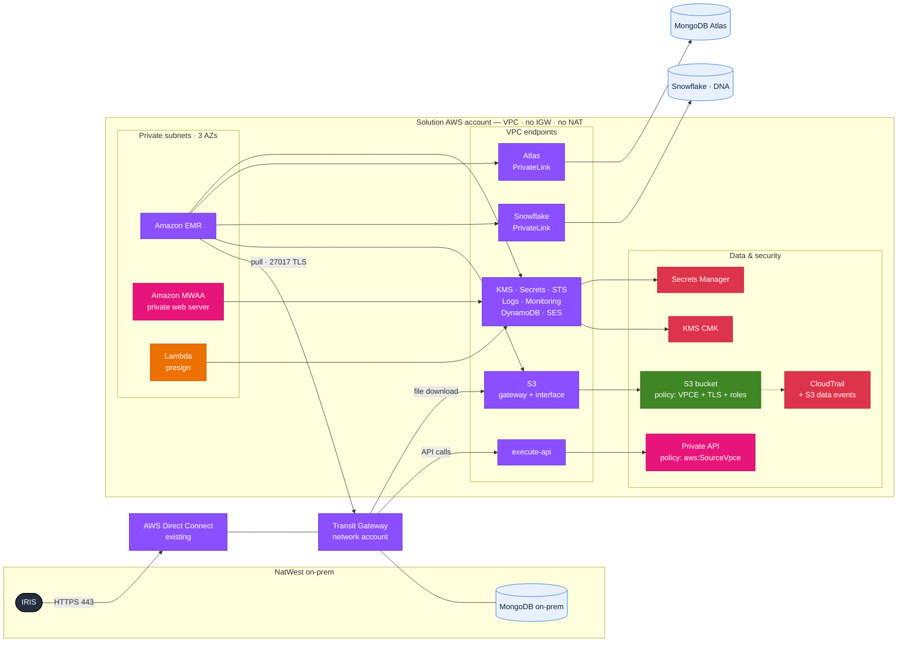

# IRIS Data Provisioning – AWS High-Level Design (HLD)

| Item | Value |
|---|---|
| Document | High-Level Design – AWS solution |
| Version | 0.1 (draft for architecture review) |
| Date | 12 Oct 2026 |
| Classification | Internal |
| Source | "Solution Overview" slide (v0.2_latest) |

> **One-line summary:** a daily, pull-based batch pipeline that extracts from Snowflake and MongoDB (on-prem and Atlas), curates into a common target model on Amazon EMR, applies business exclusions and data-quality controls, and publishes pre-generated Full and Delta files into a solution-owned S3 bucket. IRIS retrieves files only through a private API that returns a short-lived pre-signed URL – no direct S3 access, no streaming, nothing produced on demand.

---

## Contents

1. [Scope, principles and assumptions](#1-scope-principles-and-assumptions)
2. [End-to-end architecture](#2-end-to-end-architecture)
3. [Box 1 – Source Systems](#3-box-1--source-systems)
4. [Box 2 – Ingestion & Curation](#4-box-2--ingestion--curation)
5. [Box 3 – Exclusions & Controls](#5-box-3--exclusions--controls)
6. [Box 4 – Solution-owned S3](#6-box-4--solution-owned-s3)
7. [Box 5 – Consumption API for IRIS](#7-box-5--consumption-api-for-iris)
8. [Consumers, Operations & Deployment](#8-consumers-operations--deployment)
9. [Network & security architecture](#9-network--security-architecture)
10. [Non-functional requirements](#10-non-functional-requirements)
11. [Architecture decisions (ADR log)](#11-architecture-decisions-adr-log)
12. [Risks, assumptions, open questions](#12-risks-assumptions-and-open-questions)
13. [AWS service bill of materials](#13-aws-service-bill-of-materials)

---

## 1. Scope, principles and assumptions

### 1.1 In scope
- Daily extraction from **Snowflake** (via DNA platform team), **MongoDB on-prem** and **MongoDB Atlas**.
- Curation into a **common target data model**, normalising **Genesis vs Exodus** structures.
- **Business exclusion rules**, **record-count reconciliation**, **value / null / date / timezone checks**, **CSV DQ report** and **email alerts**.
- **Daily Full and incremental Delta** datasets, retained **30–60 days (TBC)**, available by **~08:00 IST (SLA TBC)**.
- A **Consumption API** that returns **one time-bound pre-signed URL** per request.

### 1.2 Out of scope
- Streaming / CDC delivery, on-demand file generation, direct S3 access by IRIS.
- Changes inside source platforms (except POROB attribute changes in the Mongo-populating app, delivered by the same team – see §8.4).

### 1.3 Design principles

| # | Principle | How it shows up |
|---|---|---|
| P1 | **Pull, never push** | Solution initiates every connection; sources expose read-only access. |
| P2 | **Pre-generate, then serve** | All files built in the batch window; the API only looks up and signs. |
| P3 | **Idempotent by `business_date`** | Any task can be re-run for a date with identical output; no manual cleanup. |
| P4 | **Publish is atomic** | Files are invisible to IRIS until a manifest is committed. |
| P5 | **Controls gate publication** | A hard DQ failure blocks publish; IRIS never gets a bad file silently. |
| P6 | **Private by default** | No IGW/NAT, VPC endpoints only, KMS everywhere, least-privilege IAM. |
| P7 | **Reuse the estate** | Existing connectivity, existing CI/CD templates, existing Airflow email. |

### 1.4 Key assumptions (validate in LLD)
- A1. Volumes are batch-scale (GB–low TB per day), not requiring sub-hour latency.
- A2. IRIS reaches AWS over the bank's private network (Direct Connect / Transit Gateway), not the internet.
- A3. "IST" means India Standard Time (UTC+05:30) → **publish deadline 02:30 UTC** (03:30 BST in summer, 02:30 GMT in winter).
- A4. File format for IRIS is **CSV (gzip)** unless IRIS confirms Parquet.
- A5. The bank's approved region is used (e.g. `eu-west-2` London); all data stays in-region.

---

## 2. End-to-end architecture



<sub>AWS-icon version: [`diagrams/01_logical_hld.png`](diagrams/01_logical_hld.png)</sub>

### 2.1 Flow summary

| Step | What happens | AWS service |
|---|---|---|
| 0 | Airflow DAG fires for `business_date = D` | Amazon MWAA |
| 1 | Parallel extracts from Snowflake, Mongo on-prem, Mongo Atlas into `raw/` | Amazon EMR (Spark) |
| 2 | Normalise Genesis/Exodus → common target model; MERGE into curated Iceberg tables | EMR + Glue Data Catalog + S3 |
| 3 | Apply exclusion rules (quarantine with reason code), reconcile counts, run DQ checks | EMR (Spark SQL + Deequ) |
| 4 | DQ gate: PASS / WARN → continue; FAIL → stop and alert | MWAA branch operator |
| 5 | Write Full + Delta to `_staging/`, verify, promote to `published/`, write manifest | EMR + Lambda + DynamoDB |
| 6 | Email DQ CSV + run status to IRIS and Ops/SRE | MWAA SMTP → SES / bank relay |
| 7 | IRIS calls API → receives pre-signed URL → downloads file over private network | API Gateway (private) + Lambda + S3 interface endpoint |

### 2.2 Daily pipeline (Airflow DAG)

```mermaid
flowchart LR
  START(["MWAA schedule<br/>business_date = D"])
  subgraph EX["Extract · parallel · idempotent"]
    direction TB
    E1["extract_snowflake"]
    E2["extract_mongo_onprem"]
    E3["extract_mongo_atlas"]
  end
  subgraph CU["Curate"]
    direction TB
    C1["normalise Genesis / Exodus<br/>→ common target model"]
    C2["MERGE into<br/>Iceberg curated"]
  end
  subgraph CO["Controls"]
    direction TB
    X1["apply exclusion rules<br/>→ quarantine + reason"]
    X2["record-count<br/>reconciliation"]
    X3["value · null ·<br/>date / tz checks"]
  end
  GATE{"DQ gate"}
  subgraph PB["Publish"]
    direction TB
    P1["write Full + Delta<br/>to _staging/"]
    P2["verify · promote ·<br/>checksum · manifest"]
  end
  MAIL["Email DQ CSV + status<br/>IRIS &amp; Ops/SRE"]
  FAIL["Stop · no publish<br/>alert"]
  SLA["CloudWatch alarm<br/>SLA ~08:00 IST"]

  START --> E1 & E2 & E3
  E1 & E2 & E3 --> C1 --> C2 --> X1
  X1 --> X2 & X3
  X2 & X3 --> GATE
  GATE -->|"PASS / WARN"| P1 --> P2 --> MAIL
  GATE -->|"FAIL"| FAIL --> MAIL
  START -.-> SLA

  classDef src fill:#E8F1FB,stroke:#1E6FD9,color:#0B2545
  classDef analytics fill:#8C4FFF,stroke:#5A2DB3,color:#fff
  classDef storage fill:#3F8624,stroke:#2A5C18,color:#fff
  classDef compute fill:#ED7100,stroke:#B35400,color:#fff
  classDef integ fill:#E7157B,stroke:#A10D55,color:#fff
  classDef db fill:#C925D1,stroke:#8E1A94,color:#fff
  classDef sec fill:#DD344C,stroke:#A11F33,color:#fff
  classDef net fill:#8C4FFF,stroke:#5A2DB3,color:#fff
  classDef actor fill:#232F3E,stroke:#000,color:#fff
  classDef bad fill:#FDECEC,stroke:#D13212,color:#7A1A0A
  class E1,E2,E3,C1,C2,X1,X2,X3,P1 analytics
  class P2 compute
  class START,MAIL integ
  class GATE actor
  class FAIL bad
  class SLA sec
```



<sub>AWS-icon version: [`diagrams/03_pipeline_dag.png`](diagrams/03_pipeline_dag.png)</sub>


> Start time depends on when source data for D is complete (Snowflake load time from DNA, Mongo business cut-off). Target: **≥ 60 min headroom** before SLA for one full retry.

---

## 3. Box 1 – Source Systems

**Slide:** Snowflake (via DNA platform team) · MongoDB on-prem (Spark connector / AWS Glue) · MongoDB Atlas · Pull mechanism; existing connectivity reused.

### 3.1 Design per source

| Source | Connector | Network path | Auth | Extraction pattern |
|---|---|---|---|---|
| **Snowflake (DNA)** | Snowflake Spark Connector + JDBC on EMR (query pushdown on) | **AWS PrivateLink for Snowflake** (interface endpoint + private DNS) | Key-pair auth for a **read-only service user / role** provisioned by DNA; private key in Secrets Manager | `SELECT … WHERE load_date = D` (or `updated_at` window) against a DNA-owned view; no table-level grants outside the view |
| **MongoDB on-prem** | **MongoDB Spark Connector 10.x** on EMR | Existing **Direct Connect → Transit Gateway** → solution VPC; firewall rule EMR subnets → mongos:27017 | SCRAM-SHA-256 (or x.509) read-only user; creds in Secrets Manager; TLS with bank CA bundle | Read from **secondary** (`readPreference=secondaryPreferred`) with aggregation pipeline pushdown filtering on `lastModified` / ObjectId time range; full snapshot for small collections |
| **MongoDB Atlas** | MongoDB Spark Connector 10.x | **Atlas private endpoint (AWS PrivateLink)** in the same region | Atlas DB user via Secrets Manager (or AWS IAM auth for Atlas, if enabled) | Same as on-prem; analytics node tags if Atlas has analytics nodes (protects OLTP) |

### 3.2 Decisions
- **One engine for all sources (EMR Spark)** rather than mixing Glue and EMR. Glue's native MongoDB connection remains a valid fallback for on-prem Mongo if the EMR → on-prem firewall change is slow, but one runtime keeps libraries, logging and operations uniform.
- **Snowflake: pull via connector, not UNLOAD.** A `COPY INTO @external_stage` push from DNA would be faster at very large volumes but breaks the "pull" principle and needs a storage integration into our bucket. Keep as an option if volumes exceed the window (see R3).
- **No change streams.** Streaming is explicitly out of scope; time-window queries are simpler and restartable.

### 3.3 Source-side asks (owners)
| Ask | Owner |
|---|---|
| Read-only Snowflake role + secure view(s), PrivateLink allow-listing, warehouse sizing & credit budget | DNA platform team |
| Mongo read-only user, firewall rule, confirm secondary reads / indexes on filter fields | Mongo DBA / app team |
| Atlas private endpoint approval & IP access list | Atlas project owner |
| Data completeness signal per business date (e.g. control table / max load timestamp) | All sources |

---

## 4. Box 2 – Ingestion & Curation

**Slide:** Amazon EMR / Spark jobs · Airflow scheduling, monitoring & alerts · Common target data model · Normalise Genesis vs Exodus structures.

### 4.1 Compute – Amazon EMR

| Choice | Recommendation |
|---|---|
| Deployment | **Transient EMR on EC2 cluster per daily run**, launched and terminated by Airflow (`EmrCreateJobFlowOperator` → steps → terminate). **EMR Serverless** is the alternative (less to manage, VPC-attached) – decide in LLD against bank-approved patterns. |
| Release | Latest EMR 7.x release approved by the bank (Spark 3.5, Iceberg runtime bundled). |
| Sizing | Instance fleets, Graviton (m7g/r7g), on-demand core + optional Spot task nodes; managed scaling. Spot only for task nodes – never for core (protects SLA). |
| Image | Custom AMI per bank hardening baseline; bootstrap installs connectors and certificates from the artefact bucket. |
| Security | Security configuration: at-rest (S3 SSE-KMS, EBS encryption), in-transit TLS, runtime roles; no SSH (SSM Session Manager only). |
| Logs | Step/driver/executor logs to `s3://…-logs/emr/` + CloudWatch agent. |

### 4.2 Data zones

| Zone | Content | Format | Retention |
|---|---|---|---|
| `raw/` | Source-shaped extract, as read, partitioned by `source/entity/business_date` | Parquet (snappy) | 30 days |
| `curated/` | **Common target data model** tables | **Apache Iceberg** (Glue Data Catalog) | Snapshots expired after 60 days |
| `controls/` | Exclusions quarantine, recon results, DQ reports | Parquet + CSV | Aligned with audit policy (TBC) |
| `published/` | IRIS-facing Full and Delta files + manifests | CSV.gz (TBC) | **30–60 days (TBC)** |

Iceberg is recommended for `curated/` because it gives ACID MERGE, snapshot time-travel (re-create any day's Full exactly), schema evolution for POROB attribute additions, and cheap rollback if a run is bad.

### 4.3 Common target model & Genesis vs Exodus normalisation
- **Config-driven mapping:** one YAML/JSON mapping per source structure (Genesis, Exodus) → canonical entity. Mapping covers field rename, type cast, nested-array explode, code-value translation and default values.
- **Structure detection:** documents carry (or are given) a `source_structure` discriminator (`GENESIS` / `EXODUS`) based on schema version field or collection; unknown structures go to quarantine, never silently dropped.
- **Canonical technical columns** on every row: `business_key`, `source_system`, `source_structure`, `source_ts_utc`, `ingest_run_id`, `business_date`, `row_hash` (SHA-256 of business columns – used for Delta).
- **Timezone standard:** all timestamps stored in **UTC** in curated; conversion to the IRIS-required timezone only at publish.
- **Schema registry:** canonical schema version stored in Glue Data Catalog; breaking changes require a new version and a contract update with IRIS.

### 4.4 Orchestration – Amazon MWAA
- Private network access mode (web server reachable only via VPC / bank network).
- DAGs, plugins and `requirements.txt` deployed from CI/CD to the MWAA S3 bucket.
- One **DAG per daily run** with `business_date` as the logical date; datasets toggled by config (supports incremental release, §7.6).
- Sensors wait for source-completeness signals (with timeout) rather than fixed clock times.
- Task retries with exponential backoff; `sla_miss_callback` + CloudWatch alarm on "not published by 02:00 UTC" (early warning before the 02:30 UTC SLA).

---

## 5. Box 3 – Exclusions & Controls

**Slide:** Business exclusion rules (SQL / PySpark) · Record-count reconciliation · Value, null, date/timezone checks · CSV DQ report + Airflow email alerts.

### 5.1 Business exclusion rules
- Rules held as **versioned SQL files** in the code repo (`rules/<dataset>/<rule_id>.sql`), each with metadata: `rule_id`, description, owner, severity, effective-from date.
- Executed as Spark SQL against curated data for D. Each rule produces the set of **excluded business keys + reason code**.
- Excluded rows are **written to `controls/quarantine/` with the rule ID**, never deleted – this provides the audit trail ("why is record X not in IRIS?").
- Rule changes go through PR review + business sign-off; the rule version is stamped into the manifest.

### 5.2 Record-count reconciliation
Each run produces a reconciliation table per dataset:

```
source_count  = landed_raw_count                         (extract completeness)
raw_count     = curated_count + rejected_count            (curation completeness)
curated_count = published_count + excluded_count          (exclusion accountability)
delta_count   = inserts + updates + deletes               (delta integrity)
```
Source counts are taken **at the source** with the same filter (`SELECT COUNT(*)` / Mongo `countDocuments`) so the reconciliation is independent of the Spark read.

### 5.3 Data-quality checks
Implemented with **PyDeequ / Deequ on EMR** (in-cluster, no extra service). Checks are declared per dataset in config:

| Category | Examples | Default severity |
|---|---|---|
| Null / completeness | Mandatory fields not null; % null under threshold for optional fields | FAIL / WARN |
| Value / domain | Enumerations, ranges, regex (e.g. sort code format), referential look-ups | FAIL |
| Uniqueness | Business key unique in Full | FAIL |
| Date / timezone | Parseable, not in future, within plausible range, UTC normalised, DST edge cases | FAIL |
| Volume drift | Today's count vs 7-day average within ±X% | WARN |
| Schema | Output schema equals contract version | FAIL |

**Gate logic:** any FAIL → publish blocked, DAG ends in failed state, alert sent. WARN → publish proceeds; warning flagged in the DQ report and manifest.

### 5.4 DQ report & alerts
- One **CSV DQ report per run** in `controls/dq_reports/business_date=D/` (check, dataset, metric, threshold, result, severity, sample keys).
- Emailed through **Airflow's existing email capability** (SMTP backend → Amazon SES via VPC endpoint, or the bank's SMTP relay). Recipients: IRIS DL + Ops/SRE DL, configured in Airflow Variables.
- Email contains summary (status, counts, SLA met?) and attaches the CSV; no customer data in the email body.

---

## 6. Box 4 – Solution-owned S3

**Slide:** Daily Full & incremental Delta datasets · 30–60 day retention (TBC) · Available by ~08:00 IST (SLA TBC) · Restart/recovery by design.

### 6.1 Buckets

| Bucket | Purpose | Key settings |
|---|---|---|
| `<org>-iris-data-<env>` | raw, curated, controls, published | SSE-KMS (customer-managed key, **S3 Bucket Key on**), versioning on, Block Public Access, Object Ownership = bucket owner enforced |
| `<org>-iris-logs-<env>` | EMR logs, S3 server access logs, API logs | SSE-KMS, lifecycle to Glacier |
| `<org>-iris-artefacts-<env>` | Spark jars/wheels, bootstrap, rules, MWAA DAGs | Versioned, write only from CI/CD role |

### 6.2 Published layout and file contract

```
published/
  dataset=<name>/
    type=FULL/business_date=2026-10-12/<name>_FULL_20261012.csv.gz
    type=DELTA/business_date=2026-10-12/<name>_DELTA_20261012.csv.gz
    _manifests/business_date=2026-10-12/manifest.json
  _staging/run_id=<uuid>/...          # never exposed to IRIS
```

`manifest.json` (also indexed in DynamoDB for the API):
```json
{
  "dataset": "accounts",
  "business_date": "2026-10-12",
  "files": [
    {"type": "FULL",  "key": ".../accounts_FULL_20261012.csv.gz",  "rows": 1834221, "bytes": 412339812, "sha256": "…"},
    {"type": "DELTA", "key": ".../accounts_DELTA_20261012.csv.gz", "rows": 10422,   "bytes": 2213004,   "sha256": "…"}
  ],
  "schema_version": "1.3",
  "rules_version": "2026.10.1",
  "dq_status": "PASS",
  "run_id": "…",
  "published_at_utc": "2026-10-12T01:47:10Z"
}
```

### 6.3 Full vs Delta generation
- **Full** = complete curated snapshot for D after exclusions.
- **Delta** = row-hash comparison of **Full(D) vs Full(D-1)** on `business_key`, emitting an `op` column: `I` (new key), `U` (hash changed), `D` (key no longer present or newly excluded).
- Deterministic and re-runnable (both inputs are immutable Iceberg snapshots); independent of source CDC quality. Iceberg's changelog view is an alternative if source updates are reliable.
- **Single object per dataset/type/date** – required because the API returns *one* URL. Spark writes parts to `_staging/`; a finaliser concatenates them into one object using **S3 multipart upload with `UploadPartCopy`** (gzip members concatenate into a valid gzip stream). Header row written once.

### 6.4 Retention (30–60 days, TBC)
- S3 Lifecycle rule on `published/` → **expire current versions after N days** (N parameterised; start at 60) and delete non-current versions after 7 days.
- `raw/` 30 days; Iceberg snapshot expiry + orphan-file cleanup scheduled weekly in Airflow.
- API returns **410 Gone** for dates beyond retention (driven by the manifest index TTL in DynamoDB).

### 6.5 Restart / recovery by design

| Failure | Behaviour |
|---|---|
| Task failure (transient) | Airflow retries (3×, backoff). Every task overwrites its own `business_date`/`run_id` partition – no duplicates. |
| EMR cluster loss | DAG re-creates cluster and resumes from the failed task; completed upstream outputs are reused. |
| Bad data published | Re-run with corrected rules for D → new files + new manifest version; previous objects retained by S3 versioning; Iceberg rollback to previous snapshot if needed. |
| Missed days | Airflow **backfill** for a date range; Delta chain recalculated in date order (`depends_on_past=True` for publish). |
| Partial publish | Impossible to observe: manifest/index written **last**, only after all files verified (rows + checksum). API reads only the index. |
| Region / AZ | Multi-AZ by default for S3, MWAA, Lambda, API GW, DynamoDB. Cross-region DR is **not** proposed unless RTO/RPO requires it (open question). |

---

## 7. Box 5 – Consumption API for IRIS

**Slide:** Inputs: Full/Delta + specific date · Returns one time-bound pre-signed URL · Python or Java, finalised in LLD · Released incrementally as SIT-ready.



<sub>AWS-icon version: [`diagrams/04_consumption_api.png`](diagrams/04_consumption_api.png)</sub>

### 7.1 Components
- **Amazon API Gateway – Private REST API**, reachable only through an `execute-api` interface VPC endpoint; **resource policy** restricts to that endpoint (`aws:SourceVpce`) and the IRIS principal.
- **AWS Lambda** `presign-handler` (Python 3.12 or Java 21 with SnapStart – LLD decision), VPC-attached, reserved concurrency set.
- **Amazon DynamoDB** table `iris-file-manifest` (PK `dataset#type`, SK `business_date`), written by the publish step; TTL attribute for retention.
- **IAM signing role** with `s3:GetObject` **only** on `published/*` and `kms:Decrypt` on the CMK – the pre-signed URL inherits only these permissions.

### 7.2 API contract (indicative)

```
GET /v1/datasets/{dataset}/files?type=FULL|DELTA&date=YYYY-MM-DD
```

| Code | Meaning |
|---|---|
| 200 | `{ "url": "...", "expiresAt": "...", "sha256": "...", "rows": n, "bytes": n, "schemaVersion": "1.3", "dqStatus": "PASS" }` |
| 400 | Invalid type/date format |
| 401 / 403 | Not authenticated / not authorised for dataset |
| 404 | Dataset unknown or not released to this environment |
| 409 | Run for date in progress / not yet published (`Retry-After` header) |
| 410 | Date outside retention window |
| 429 | Throttled (usage plan) |

Optional companion: `GET /v1/datasets/{dataset}/availability?date=` for IRIS to poll readiness cheaply.

### 7.3 Pre-signed URL design
- **Expiry: 15 minutes (configurable)** – enough to start the download; S3 does not cut an in-progress transfer at expiry.
- Signed with **SigV4** by the Lambda role. Note: a URL signed with temporary credentials stops working when those credentials expire, even if the URL's expiry is later – another reason to keep TTL short.
- Generated with `ResponseContentDisposition` set to the file name.
- **"No direct S3 access" is enforced, not assumed:** IRIS has no IAM permissions on the bucket; the bucket policy denies all requests not arriving via the solution's **S3 interface endpoint** (`aws:SourceVpce`) and not over TLS. The URL is therefore useless outside the bank network.
- IRIS resolves the S3 interface-endpoint DNS name (private DNS / Route 53 Resolver inbound endpoint from on-prem) so the download stays on Direct Connect.

### 7.4 Authentication options (decide with IRIS / security)

| Option | Fit |
|---|---|
| **IAM SigV4** – IRIS assumes a role in the solution account | Best if IRIS runs in AWS. Strongest, no secrets. |
| **Lambda authorizer validating OAuth2 client-credentials JWT** from the bank IdP | Best if IRIS is on-prem / non-AWS. |
| mTLS (custom domain) | Add-on if the bank mandates certificate-based client auth. |

### 7.5 Language choice (Python vs Java)
Both are fully supported. **Python** – smallest code (boto3 `generate_presigned_url`), fastest cold start, same language as PySpark rules. **Java** – aligns with the team delivering POROB Java changes (§8.4); use **SnapStart** to remove cold-start penalty. Recommendation: Python unless team skills favour Java.

### 7.6 Incremental, SIT-ready release
- Dataset availability controlled by **feature flags per environment** (SSM Parameter Store / AppConfig): `accounts: {sit: true, uat: false, prod: false}`.
- Same API version; new datasets become visible as they pass SIT. Unreleased → 404.
- Contract tests (OpenAPI spec in repo) run in the pipeline for every release.

### 7.7 API observability & audit
Access logs (JSON) to CloudWatch Logs, X-Ray tracing, CloudWatch metrics (4xx/5xx, latency, URL issuance per dataset). **CloudTrail S3 data events** on `published/` prove which files were actually downloaded and when.

---

## 8. Consumers, Operations & Deployment

### 8.1 Consumer interaction (sequence)



### 8.2 Notifications
- Pipeline and DQ failures notified to **IRIS and Operations/SRE** via Airflow email (as per slide).
- Recommended addition: CloudWatch alarms → SNS → the bank's incident tool (ServiceNow/PagerDuty) for **SLA breach**, **DAG failure**, **API 5xx rate**, so on-call does not depend on an inbox.

### 8.3 Operations
- **Runbook** per failure scenario in §6.5; re-run and backfill are Airflow UI actions, no ad-hoc scripts.
- **Dashboards:** CloudWatch dashboard – run duration per stage, publish time vs SLA, row counts, DQ status, API calls/errors, EMR cost per run.
- **Cost controls:** transient EMR, Graviton, managed scaling, S3 lifecycle, budgets + anomaly detection on the account.

### 8.4 Deployment

```mermaid
flowchart LR
  DEVS(["Engineering team"])
  subgraph CICD["NatWest CI/CD · existing templates"]
    direction TB
    S1["lint + unit tests<br/>PySpark · rules fixtures"]
    S2["IaC plan"]
    S3S["security scans<br/>SAST · IaC policy · deps"]
    S1 --> S2 --> S3S
  end
  ART["S3 artefacts<br/>DAGs · Spark jars/wheels<br/>rules SQL · Lambda pkg"]
  subgraph ENVS["AWS environments · separate accounts"]
    direction LR
    DEV["DEV"] --> SIT["SIT"] --> UAT["UAT / pre-prod"] -->|"change approval"| PROD["PROD<br/>new AWS environment"]
  end
  DEVS --> S1
  S3S --> ART --> DEV

  classDef src fill:#E8F1FB,stroke:#1E6FD9,color:#0B2545
  classDef analytics fill:#8C4FFF,stroke:#5A2DB3,color:#fff
  classDef storage fill:#3F8624,stroke:#2A5C18,color:#fff
  classDef compute fill:#ED7100,stroke:#B35400,color:#fff
  classDef integ fill:#E7157B,stroke:#A10D55,color:#fff
  classDef db fill:#C925D1,stroke:#8E1A94,color:#fff
  classDef sec fill:#DD344C,stroke:#A11F33,color:#fff
  classDef net fill:#8C4FFF,stroke:#5A2DB3,color:#fff
  classDef actor fill:#232F3E,stroke:#000,color:#fff
  class S1,S2,S3S integ
  class ART storage
  class DEV,SIT,UAT,PROD net
  class DEVS actor
```



<sub>AWS-icon version: [`diagrams/05_deployment.png`](diagrams/05_deployment.png)</sub>

- Uses **NatWest's existing CI/CD templates**; exercised **from the development phase**, including deployment into the **new AWS environment** once available.
- Everything as code: VPC endpoints, buckets, KMS, IAM, MWAA, EMR configs, API, Lambda, DynamoDB, alarms (Terraform or CloudFormation/CDK – whichever the template mandates).
- Pipeline stages: lint → unit tests (PySpark local, rules tests with fixtures) → IaC plan → security scanning (SAST, IaC policy-as-code, dependency scan) → deploy DEV → SIT → UAT → PROD with change approval.
- Environments in **separate AWS accounts**, identical topology, environment-specific config only.
- **POROB attributes:** where new attributes need changes to the application populating the Mongo collections, the related Java/API changes are delivered by the same team; the curated schema absorbs additive fields via Iceberg schema evolution, and the IRIS file contract version is bumped.

---

## 9. Network & security architecture



<sub>AWS-icon version: [`diagrams/02_network_security.png`](diagrams/02_network_security.png)</sub>

### 9.1 Network
- Solution VPC with **private subnets across 3 AZs**; **no Internet Gateway, no NAT**.
- Attached to the bank's **Transit Gateway** (reusing existing Direct Connect) for on-prem Mongo and IRIS.
- **VPC endpoints:** S3 (gateway for EMR, interface for IRIS downloads), execute-api, KMS, Secrets Manager, STS, CloudWatch Logs/Monitoring, DynamoDB, SES (if used), plus PrivateLink to **Snowflake** and **MongoDB Atlas**. Endpoint policies restrict to solution resources.
- Security groups: EMR → Mongo 27017, → Snowflake 443, → endpoints 443 only; Lambda → endpoints 443 only.

### 9.2 Identity & access
- Separate IAM roles: EMR job runtime role, MWAA execution role, Lambda signing role, CI/CD deploy role, read-only support role. No human write access in PROD.
- Permission boundaries + SCPs from the landing zone.
- All secrets (Snowflake key pair, Mongo creds) in **Secrets Manager** with rotation; never in DAGs or Spark configs.

### 9.3 Data protection
- **Customer-managed KMS keys** per environment (key policy limited to the roles above); S3 Bucket Keys to reduce KMS cost.
- TLS 1.2+ everywhere; bucket policy denies `aws:SecureTransport = false`.
- **Amazon Macie** (optional) scan on `published/` to catch unexpected PII fields.
- Logging: CloudTrail (management + S3 data events on published/), VPC Flow Logs, S3 access logs, API access logs – retained per bank policy.
- Detection: GuardDuty, Security Hub, AWS Config rules (public bucket, unencrypted resources, open SGs).

---

## 10. Non-functional requirements

| NFR | Target (proposed) | Design response |
|---|---|---|
| Availability of files | By 08:00 IST (02:30 UTC) daily – **TBC** | Early start on source-ready sensors, ≥60 min retry headroom, SLA early-warning alarm |
| API availability | 99.9% | Fully managed, multi-AZ services |
| API latency | p95 < 500 ms (URL issuance) | Lookup + sign only; no data in path |
| Recoverability | Re-run any date within retention | Idempotent tasks, Iceberg time-travel, S3 versioning |
| RPO / RTO | TBC | In-region multi-AZ; cross-region only if required |
| Scalability | Volume growth ×5 without redesign | EMR managed scaling, Spark pushdown |
| Auditability | Every excluded/published/downloaded record traceable | Quarantine with rule ID, manifest, CloudTrail data events |
| Security | Bank control framework | §9 |

---

## 11. Architecture decisions (ADR log)

| ID | Decision | Alternatives considered | Rationale |
|---|---|---|---|
| ADR-01 | EMR Spark for all sources | Glue for Mongo, EMR for Snowflake | One runtime, one set of connectors and logs |
| ADR-02 | Transient EMR on EC2 (EMR Serverless as option) | Long-running cluster | Cost, clean state per run, bank-approved pattern |
| ADR-03 | Iceberg for curated layer | Plain Parquet partitions | ACID MERGE, time-travel, schema evolution |
| ADR-04 | Delta = hash diff of consecutive Fulls | Source CDC / timestamps | Deterministic, re-runnable, catches deletes |
| ADR-05 | Single object per dataset/type/date | Multiple parts / zip | API contract = one URL |
| ADR-06 | Manifest-last atomic publish | Write directly to published/ | No partial reads, clean recovery |
| ADR-07 | Private API GW + Lambda presign | ALB + container service; Transfer Family | Serverless, minimal surface, cheapest at low TPS |
| ADR-08 | Bucket policy restricted to S3 VPCE | Rely on URL secrecy | Enforces "no direct S3 access" and network locality |
| ADR-09 | Deequ inside EMR for DQ | Glue Data Quality, Great Expectations | No extra runtime; Glue DQ viable if Glue is adopted |

---

## 12. Risks, assumptions and open questions

### 12.1 Risks

| ID | Risk | Impact | Mitigation |
|---|---|---|---|
| R1 | Source data for D not complete in time for 08:00 IST | SLA miss | Agree source-ready signal + cut-off; early-warning alarm; SLA defined as "N hours after source-ready" |
| R2 | Mongo extracts load production clusters | Source performance | Secondary / analytics nodes, indexed filters, off-peak window, throttled partitions |
| R3 | Snowflake volume too large for connector in window | SLA miss / credit cost | Pushdown + right-sized warehouse; fallback to DNA-run `UNLOAD` into a stage |
| R4 | Very large single files (multi-GB) for IRIS | Download failures | Ranged GETs by IRIS; agree max size, otherwise split contract (manifest with N URLs) |
| R5 | IRIS cannot resolve S3 interface endpoint from on-prem | Downloads fail | Route 53 Resolver inbound endpoint / DNS forwarding agreed early |
| R6 | New AWS environment not ready in time | Delivery delay | Build and test in DEV account with same IaC; promotion is a parameter change |
| R7 | Genesis/Exodus semantic differences beyond structure | Wrong data | Business sign-off on mapping; reconciliation per structure |

### 12.2 Open questions (to close in LLD)
1. Confirm SLA (08:00 IST) and what happens on a missed day (publish late vs skip).
2. Retention: 30 or 60 days? Any regulatory hold requirement on published files?
3. File format (CSV vs Parquet), delimiter, encoding, header, compression, max file size.
4. Timezone IRIS expects for date/timestamp fields.
5. IRIS hosting (AWS account vs on-prem) → authentication option (§7.4).
6. Delta semantics: include deletes and exclusion-driven removals as `D`?
7. Python or Java for the API (§7.5).
8. DR requirements (RTO/RPO) – single-region acceptable?
9. Email route: SES in the new account or bank SMTP relay?
10. EMR on EC2 vs EMR Serverless per bank-approved patterns.

---

## 13. AWS service bill of materials

| Layer | Services |
|---|---|
| Orchestration | Amazon MWAA |
| Compute | Amazon EMR (on EC2 / Serverless), AWS Lambda |
| Storage & catalog | Amazon S3, Apache Iceberg, AWS Glue Data Catalog, Amazon DynamoDB |
| API | Amazon API Gateway (Private REST) |
| Networking | VPC, Transit Gateway, Direct Connect (existing), VPC endpoints, AWS PrivateLink (Snowflake, Atlas), Route 53 Resolver |
| Security | IAM, KMS, Secrets Manager, CloudTrail, GuardDuty, Security Hub, AWS Config, Macie (optional) |
| Observability | CloudWatch (metrics, logs, alarms, dashboards), X-Ray, SNS |
| Messaging | Amazon SES or bank SMTP relay |
| Config | SSM Parameter Store / AWS AppConfig |
| Delivery | NatWest CI/CD templates + IaC |

---
*Diagrams are written in Mermaid and render natively on GitHub, GitLab, Azure DevOps, Confluence (Mermaid macro), Obsidian and Typora (VS Code needs the "Markdown Preview Mermaid Support" extension). AWS-icon PNG versions are in `diagrams/`; `make_diagrams.py` regenerates them. For a single file with the AWS-icon images embedded, use `IRIS_Data_Provisioning_HLD_embedded.md`.*
